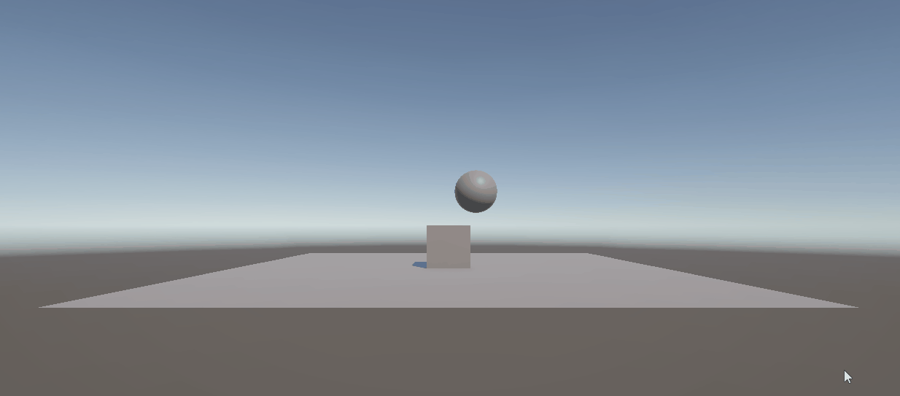
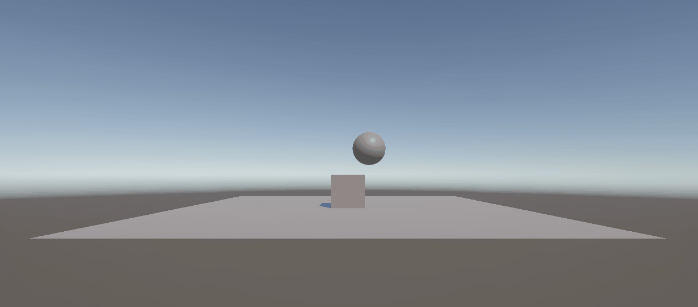
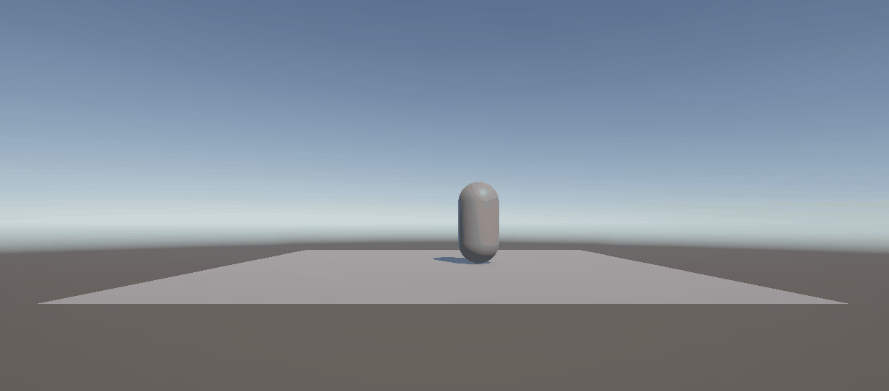
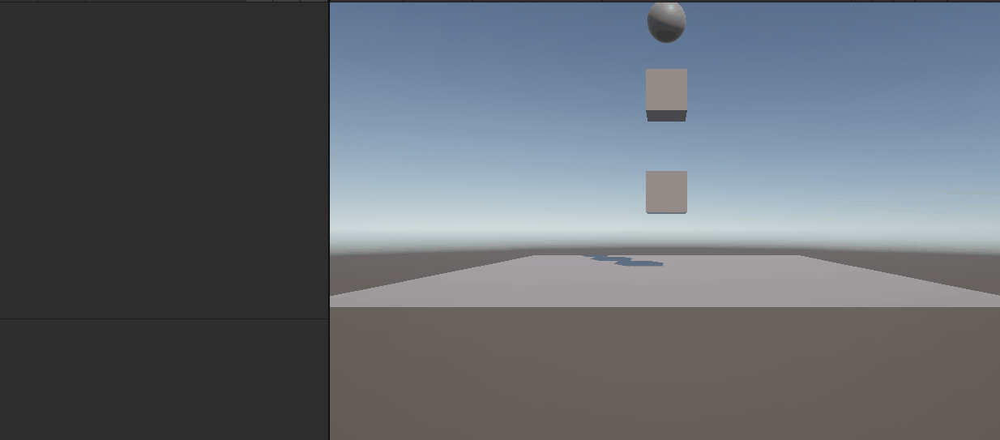
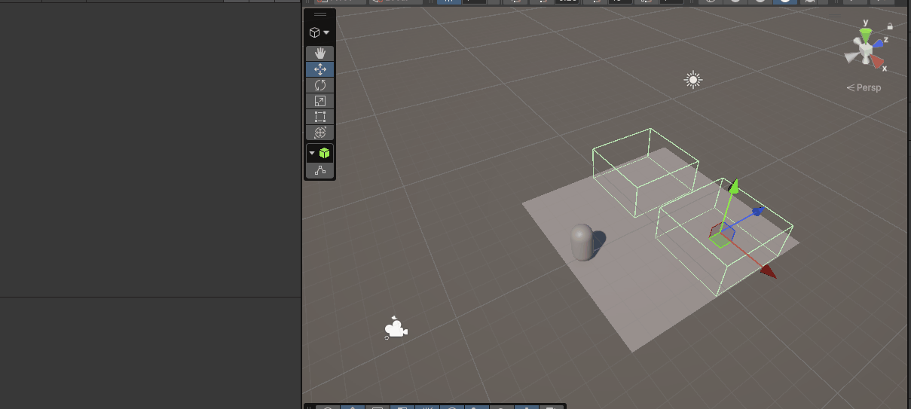
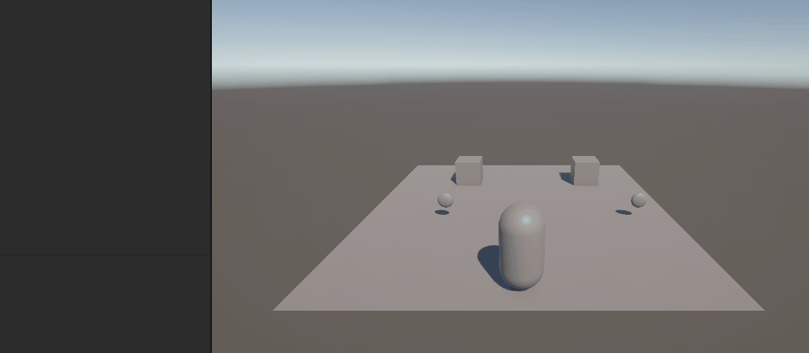
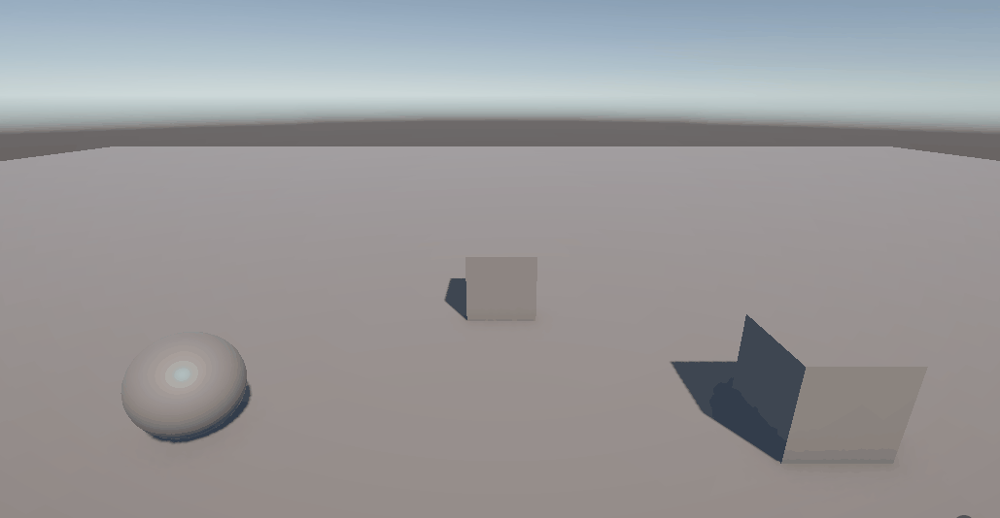
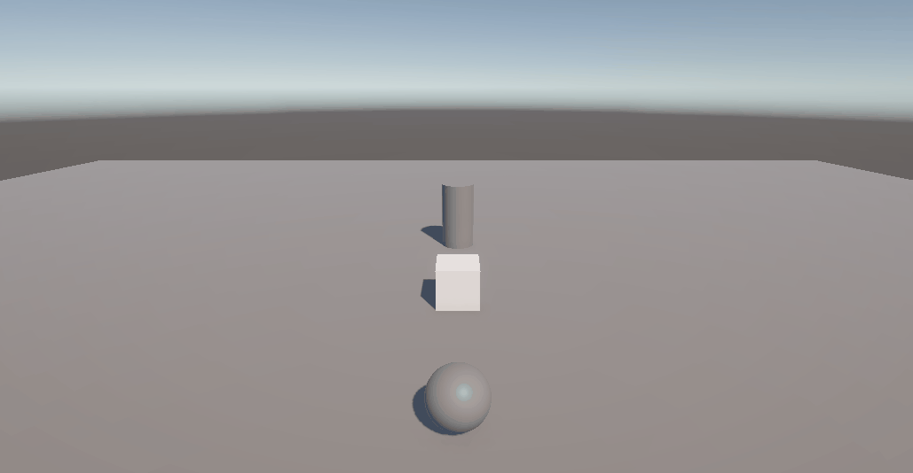

# Práctica 3 - Introducción a Físicas 3D

Esta práctica introduce el sistema de físicas de Unity mediante la experimentación con distintas configuraciones de los componentes `Rigidbody` y `Collider`.

La escena utilizada está formada por tres objetos:

- Un plano.
- Un cubo.
- Una esfera.

A partir de esta escena base se modifican las propiedades físicas de los objetos para observar el efecto de la gravedad, las colisiones, la masa, los objetos cinemáticos, la amortiguación y los `Trigger`.

---

# Experimentación con Rigidbody y Collider

## Situación 1

### Configuración

- El plano dispone únicamente de `Collider`.
- El cubo dispone de `Collider` y `Rigidbody`.
- La esfera dispone únicamente de `Collider`.

### Resultado observado

La esfera permanece suspendida en su posición inicial y no cae.

Esto ocurre porque disponer de un `Collider` no convierte al objeto en un objeto físico dinámico. Al no tener un componente `Rigidbody`, la esfera no es procesada por el motor de físicas en cuanto a gravedad y movimiento.

El `Collider` únicamente define la geometría utilizada en caso de colisión.

### Ejecución



---

## Situación 2

### Configuración

- El plano dispone únicamente de `Collider`.
- El cubo dispone de `Collider` y `Rigidbody`.
- La esfera dispone de `Collider` y `Rigidbody`.

### Resultado observado

La esfera cae debido a la gravedad, colisiona con el cubo y posteriormente rueda sobre el plano.

Al añadir `Rigidbody` a la esfera, esta comienza a ser controlada por el motor de físicas y responde a la gravedad.

El plano funciona como un `Static Collider`: participa en las colisiones, pero al no disponer de `Rigidbody` permanece inmóvil. La esfera y el cubo, en cambio, son objetos físicos dinámicos y pueden reaccionar a las colisiones.

### Ejecución



---

## Situación 3

### Configuración

- El plano dispone únicamente de `Collider`.
- El cubo dispone de `Collider` y `Rigidbody`.
- La esfera dispone de `Collider` y `Rigidbody` con `Is Kinematic` activado.

### Resultado observado

La esfera permanece suspendida en el aire y no cae.

Al activar `Is Kinematic`, el `Rigidbody` deja de ser desplazado por el motor de físicas. Por tanto, aunque el objeto siga disponiendo de un `Rigidbody`, no responde a la gravedad como un objeto dinámico.

Esta configuración permite mantener un objeto dentro del sistema de físicas pero controlar su movimiento de otra forma.

### Ejecución


---

## Situación 4

### Configuración

- El plano dispone de `Collider` y `Rigidbody`.
- El cubo dispone de `Collider` y `Rigidbody`.
- La esfera dispone de `Collider` y `Rigidbody`.

### Resultado observado

Los tres elementos caen al vacío.

Al añadir un `Rigidbody` dinámico también al plano, este deja de actuar como una superficie estática y pasa a responder a la gravedad.

Como ya no existe ningún objeto inmóvil que actúe como suelo, el plano, el cubo y la esfera son desplazados por el motor de físicas y terminan cayendo.

### Ejecución


---

## Situación 5

### Configuración

- El plano dispone de `Rigidbody` cinemático.
- El cubo es un objeto físico dinámico.
- La esfera es un objeto físico dinámico con una masa 10 veces superior a la del cubo.

### Resultado observado

La esfera cae sobre el cubo y provoca cierto desplazamiento sobre él, aunque el movimiento del cubo todavía es relativamente reducido.

La diferencia de masas influye en la respuesta de ambos objetos durante la colisión. Al tener la esfera una masa considerablemente superior, su impacto afecta al cubo, mientras que la esfera se ve proporcionalmente menos afectada.

El plano permanece estable al estar configurado como cinemático.

### Ejecución


---

## Situación 6

### Configuración

- El plano dispone de `Rigidbody` cinemático.
- El cubo es un objeto físico dinámico.
- La esfera es un objeto físico dinámico con una masa 100 veces superior a la del cubo.

### Resultado observado

En esta situación el cubo es desplazado de forma mucho más evidente por la esfera.

Al aumentar todavía más la diferencia de masas, el efecto de la colisión sobre el objeto más ligero se hace mucho más visible. La esfera prácticamente mantiene su trayectoria mientras que el cubo recibe un desplazamiento considerable.

La comparación entre las situaciones 5 y 6 permite observar claramente la influencia de la masa en la interacción entre objetos físicos.

### Ejecución


---

## Situación 7

### Configuración

Los tres objetos participan en la simulación física y se experimenta con las propiedades que afectan a la pérdida de velocidad y rotación.

### Resultado observado

En vista de que configurar mediante un `Physic Material` asociado al `Collider` la fricción no habían resultados visibles, supongo que debido a la naturaleza de la esfera, he modificado `Linear Damping` y `Angular Damping`.

Al modificar `Linear Damping` se puede controlar cuánto se reduce progresivamente la velocidad lineal del objeto, haciendo que su movimiento se detenga antes o se prolongue durante más tiempo.

De forma similar, `Angular Damping` afecta a la velocidad de rotación, permitiendo que la esfera continúe rodando durante más tiempo o que su rotación se amortigüe rápidamente.

### Ejecución


---

## Situación 8

### Configuración

- El plano se configura como objeto cinemático.
- El cubo permanece como objeto físico.
- La esfera no participa como objeto físico dinámico y su `Collider` se configura como `Trigger`.

### Resultado observado

La esfera permanece suspendida y no se observa una reacción física visible.

Al no comportarse como un `Rigidbody` dinámico, la esfera no cae debido a la gravedad. Además, al estar configurada como `Trigger`, sus intersecciones con otros `Collider` no generan una respuesta física convencional.

Los `Trigger` están destinados principalmente a detectar entradas, permanencias y salidas mediante eventos como:

```csharp
OnTriggerEnter()
OnTriggerStay()
OnTriggerExit()
```

Por tanto, mientras no exista un script que responda a dichos eventos, puede no observarse ningún efecto visible.

### Ejecución


---

## Situación 9

### Configuración

- El plano se configura como objeto cinemático.
- El cubo permanece como objeto físico.
- La esfera es un objeto físico dinámico cuyo `Collider` tiene activada la propiedad `Is Trigger`.

### Resultado observado

La esfera cae por efecto de la gravedad, pero atraviesa tanto el cubo como el plano.

Esto ocurre porque un `Trigger` detecta la intersección entre los `Collider`, pero no produce una reacción física que impida que los objetos se atraviesen.

Aunque visualmente la esfera cruza los demás objetos, Unity puede generar los correspondientes eventos:

```csharp
OnTriggerEnter()
OnTriggerStay()
OnTriggerExit()
```

Estos eventos se utilizarán posteriormente mediante scripts para ejecutar acciones al entrar o salir de determinadas zonas.

### Ejecución


---

## Conclusiones de las configuraciones físicas

Las distintas situaciones permiten observar la diferencia entre los principales tipos de objetos físicos de Unity.

Un objeto que únicamente dispone de `Collider` puede participar en colisiones pero no responde automáticamente a gravedad o fuerzas. Al añadir un `Rigidbody`, pasa a formar parte de la simulación física dinámica. Si se activa `Is Kinematic`, el objeto deja de ser desplazado por el motor de físicas aunque conserve su capacidad para participar en determinadas interacciones.

También se ha comprobado que la masa modifica la respuesta de los objetos durante las colisiones y que las propiedades de amortiguación permiten controlar la pérdida progresiva de velocidad lineal y angular.

Finalmente, los `Trigger` permiten detectar intersecciones sin generar una reacción física, lo que resulta útil para implementar zonas de interacción mediante eventos.

---

# Ejercicios con scripts y físicas

## Ejercicio 1 - Movimiento de un personaje mediante Rigidbody

Se creó un personaje utilizando una cápsula y se implementó su movimiento mediante un componente `Rigidbody`.

El personaje puede desplazarse utilizando las teclas `WASD` o las flechas de dirección. Para mantener un control directo sobre su movimiento se configuró el `Rigidbody` como cinemático.

La entrada del usuario se recoge mediante los ejes `Horizontal` y `Vertical`:

```csharp
float horizontal = Input.GetAxis("Horizontal");
float vertical = Input.GetAxis("Vertical");
```

A partir de estos valores se construye un vector de movimiento sobre el plano XZ:

```csharp
movement = new Vector3(horizontal, 0.0f, vertical);
```

Para evitar que el personaje se desplace más rápido en diagonal, el vector se normaliza cuando su magnitud es superior a 1.

El desplazamiento se realiza en `FixedUpdate()` mediante `Rigidbody.MovePosition()`:

```csharp
Vector3 nuevaPosicion =
    rb.position + movement * speed * Time.fixedDeltaTime;

rb.MovePosition(nuevaPosicion);
```

De esta forma el movimiento se realiza utilizando el `Rigidbody` en lugar de modificar directamente el `Transform`.

### Ejecución



---

## Ejercicio 2 - Detección de colisiones y cambio de color

Se crearon varios objetos con `Rigidbody` dinámico y sus respectivos `Collider`.

Se implementó un script común que utiliza el evento:

```csharp
OnCollisionEnter(Collision collision)
```

Cuando un objeto comienza una colisión, se muestra en consola el nombre del objeto con el que ha colisionado:

```csharp
Debug.Log(
    gameObject.name + " ha colisionado con " +
    collision.gameObject.name
);
```

Además, el objeto modifica su color a uno generado aleatoriamente:

```csharp
objetoRenderer.material.color = new Color(
    Random.Range(0.0f, 1.0f),
    Random.Range(0.0f, 1.0f),
    Random.Range(0.0f, 1.0f)
);
```

Al tener varios objetos dinámicos con el mismo script, una colisión puede generar eventos en ambos participantes.

### Ejecución



---

## Ejercicio 3 - Zonas Trigger

Se crearon dos zonas mediante objetos con un `Collider` configurado con:

```text
Is Trigger = true
```

Los triggers permiten detectar cuándo otro objeto entra o sale de una zona sin producir una respuesta física que impida atravesarla.

### Zona de cambio de color

La primera zona modifica temporalmente el color del personaje.

El personaje se identifica mediante el tag:

```text
Player
```

Cuando entra en la zona se ejecuta:

```csharp
void OnTriggerEnter(Collider other)
```

y, si el objeto detectado es el jugador, se cambia el color de su `Renderer`.

Al abandonar la zona se ejecuta:

```csharp
void OnTriggerExit(Collider other)
```

restaurando el color original.

De esta forma el efecto únicamente permanece activo mientras el personaje se encuentra dentro del trigger.

### Zona de daño

También se añadió una segunda zona encargada de incrementar una variable de daño almacenada en el personaje.

El personaje dispone de un componente `PlayerHealth`:

```csharp
public int damage = 0;
```

Cuando entra en la zona se obtiene este componente:

```csharp
PlayerHealth playerHealth =
    other.GetComponent<PlayerHealth>();
```

y se incrementa el daño:

```csharp
playerHealth.damage += damageAmount;
```

Cada nueva entrada en la zona vuelve a aumentar el valor.

### Ejecución



---

## Ejercicio 4 - Capas y matriz de colisiones

Se crearon tres capas diferentes para clasificar los objetos de la escena:

```text
Player
Enemies
Collectibles
```

La cápsula utilizada como personaje pertenece a la capa `Player`, los objetos enemigos a `Enemies` y los objetos recolectables a `Collectibles`.

La interacción entre estas capas se configuró mediante:

```text
Project Settings → Physics → Layer Collision Matrix
```

La configuración utilizada permite las siguientes interacciones:

```text
Player ↔ Enemies        activada
Player ↔ Collectibles   activada

Enemies ↔ Enemies       desactivada
Enemies ↔ Collectibles  desactivada
Collectibles ↔ Collectibles desactivada
```

Los enemigos disponen de colliders normales, por lo que producen una colisión física con el jugador.

Los recolectables, en cambio, tienen activado `Is Trigger`. De esta forma pueden ser atravesados por el jugador y únicamente generan eventos de tipo trigger.

Para comprobar su funcionamiento se implementó un mensaje cuando el personaje atraviesa un recolectable:

```csharp
void OnTriggerEnter(Collider other)
{
    if (other.CompareTag("Player"))
    {
        Debug.Log("Recolectable detectado: " + gameObject.name);
    }
}
```

### Ejecución



---

## Ejercicio 5 - Materiales físicos y aplicación de fuerzas

Se creó una escena con objetos que utilizan distintos `Physics Material` para observar cómo afectan la fricción y el rebote al comportamiento físico.

Se utilizaron tres materiales principales:

### Material resbaladizo

Configurado con valores mínimos de fricción:

```text
Static Friction  = 0
Dynamic Friction = 0
Friction Combine = Minimum
```

El objeto mantiene su desplazamiento durante más tiempo al producirse poco rozamiento con la superficie.

### Material rugoso

Configurado con valores elevados de fricción:

```text
Static Friction  = 1
Dynamic Friction = 1
Friction Combine = Maximum
```

El objeto pierde velocidad mucho más rápidamente.

Durante las primeras pruebas se utilizaron esferas para comparar ambos materiales, pero la diferencia era poco evidente debido a que los objetos tendían a rodar. Por este motivo se utilizaron cubos para hacer más visible el efecto de la fricción.

### Material con rebote

El tercer material se configuró con:

```text
Bounciness = 1
Bounce Combine = Maximum
```

El valor máximo permitido para `Bounciness` es 1. Utilizar `Bounce Combine = Maximum` permitió hacer mucho más evidente el efecto del rebote al combinar el material del objeto con el del suelo.

Los objetos se lanzan al pulsar la tecla `X` mediante:

```csharp
rb.AddForce(direction * force, ForceMode.Impulse);
```

Se utilizó `ForceMode.Impulse` para aplicar una fuerza instantánea a cada objeto.

Las pruebas permiten observar claramente tres comportamientos distintos:

- El objeto resbaladizo mantiene el movimiento durante más tiempo.
- El objeto rugoso se detiene antes.
- El objeto con alto rebote vuelve a elevarse al impactar contra el suelo.

### Ejecución



---

## Ejercicio 6 - Movimiento hacia un objetivo y detección mediante Collider

En la escena se colocaron tres objetos alineados:

```text
Sphere → Cube → Cylinder
```

El cilindro actúa como objetivo de la esfera y el cubo se encuentra entre ambos como obstáculo.

Los tres objetos disponen de `Collider`, pero ninguno tiene `Rigidbody`, tal y como se especifica en el ejercicio.

La esfera se desplaza continuamente hacia el cilindro mediante:

```csharp
transform.position = Vector3.MoveTowards(
    transform.position,
    target.position,
    speed * Time.deltaTime
);
```

El cilindro se asigna como objetivo desde el Inspector mediante una referencia a su `Transform`.

Para detectar cuándo la esfera alcanza el cubo se utilizan los límites de ambos colliders:

```csharp
sphereCollider.bounds.Intersects(obstacle.bounds)
```

Cuando sus volúmenes comienzan a intersectar, se modifica el material del cubo:

```csharp
obstacleRenderer.material = obstacleMaterial;
```

Se utiliza además una variable booleana para evitar repetir el cambio de material continuamente mientras ambos objetos permanecen solapados.

La secuencia obtenida es:

```text
La esfera comienza a avanzar
        ↓
alcanza el cubo
        ↓
el cubo cambia de material
        ↓
la esfera continúa avanzando
        ↓
alcanza el cilindro
```

### Ejecución



---

# Conclusiones

Esta segunda parte de la práctica ha permitido trabajar con diferentes mecanismos del sistema de físicas de Unity.

Se ha utilizado `Rigidbody` tanto para movimiento controlado como para objetos completamente dinámicos, y se han empleado eventos como `OnCollisionEnter()` y `OnTriggerEnter()` para responder a interacciones entre objetos. Los apuntes distinguen precisamente los eventos de colisión física de los eventos trigger, en los que existe detección pero no una respuesta física convencional. 

También se ha utilizado la `Layer Collision Matrix` para controlar qué tipos de objetos pueden interactuar entre sí, así como distintos `Physics Material` para modificar propiedades como la fricción y el rebote.

Finalmente, se ha experimentado con `Rigidbody.AddForce()` para aplicar impulsos físicos y con la detección manual de intersecciones entre `Collider` en una escena formada exclusivamente por objetos sin `Rigidbody`.