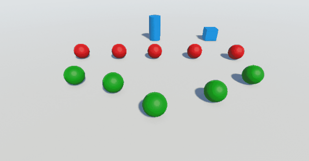
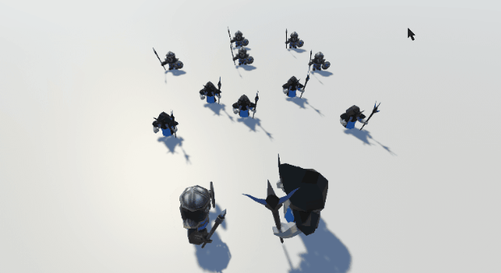
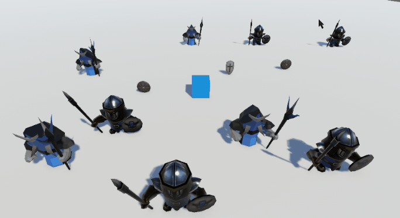
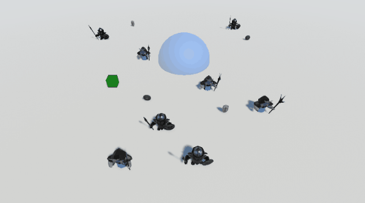
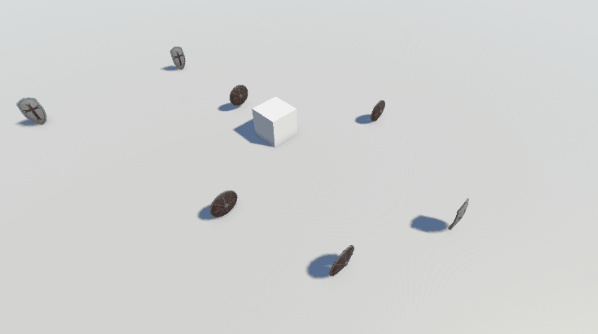
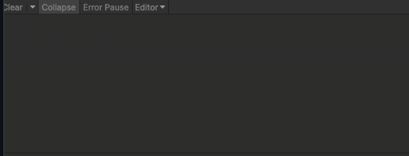
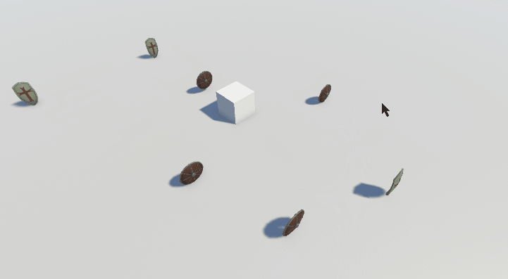
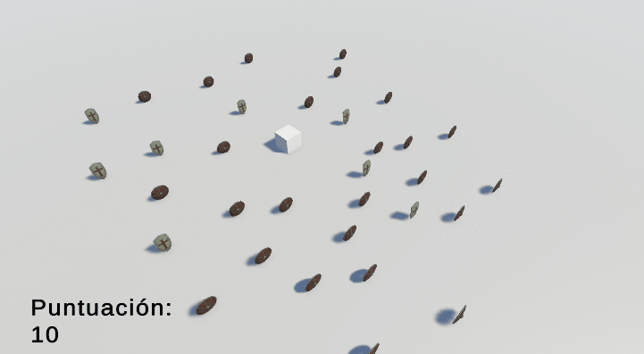
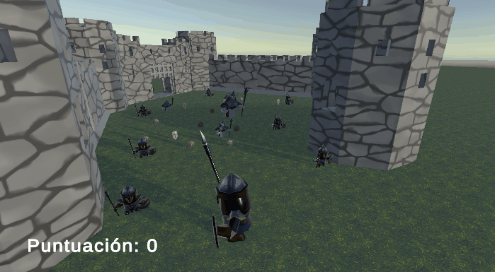

# Práctica 4 - Patrón Observador y Eventos en Unity

En esta práctica se implementan distintas mecánicas en Unity utilizando principalmente delegados, eventos y el patrón Observador. A partir de una escena inicial con objetos geométricos, las mecánicas se amplían progresivamente utilizando humanoides, escudos, detección de proximidad, puntuación e interfaz de usuario.

---

## Ejercicio 1 - Comunicación mediante eventos

Se creó una escena con un cubo, un cilindro y dos grupos de esferas diferenciados mediante etiquetas y materiales.

- Las esferas de **Tipo 1** son rojas.
- Las esferas de **Tipo 2** son verdes.

El cilindro actúa como **notificador**. Cuando detecta una colisión con el cubo lanza el evento:

```csharp
public delegate void AvisoImpacto();
public event AvisoImpacto AlImpactarCubo;
```

La colisión se detecta mediante:

```csharp
void OnCollisionEnter(Collision choque)
{
    if (choque.gameObject.CompareTag("Cubo"))
    {
        AlImpactarCubo?.Invoke();
    }
}
```

Cada esfera dispone del script `EsferaPerseguidora`, que se suscribe al evento del cilindro.

Las esferas reaccionan de forma diferente dependiendo de su tipo:

```csharp
if (CompareTag("Tipo1"))
{
    cilindroAviso.AlImpactarCubo += IrAMeta;
}
else if (CompareTag("Tipo2"))
{
    cilindroAviso.AlImpactarCubo += IrACilindro;
}
```

Cuando se produce la colisión:

- Las esferas de Tipo 1 se desplazan hacia una esfera de Tipo 2 seleccionada previamente.
- Las esferas de Tipo 2 se desplazan hacia el cilindro.

El movimiento se realiza calculando el vector hacia el objetivo y normalizándolo:

```csharp
Vector3 vectorHacia =
    objetivoActual.position - transform.position;

transform.Translate(
    Time.deltaTime * rapidez * vectorHacia.normalized,
    Space.World
);
```

### Ejecución



---

## Ejercicio 2 - Sustitución por humanoides

Se sustituyeron los objetos geométricos de la escena por modelos humanoides.

Se mantuvo la organización en dos grupos, preparando los objetos para reutilizar las mecánicas basadas en eventos de los ejercicios posteriores.

Los humanoides conservan las etiquetas que permiten distinguir entre:

```text
Tipo1
Tipo2
```

De esta forma la lógica de comportamiento puede depender de la categoría del humanoide independientemente del modelo visual utilizado.

### Ejecución



---

## Ejercicio 3 - Humanoides y escudos

La escena anterior se amplió incorporando dos grupos de humanoides y dos tipos de escudos.

El script `AgenteHumanoide` define dos eventos:

```csharp
public static event Notificacion AlChocarCuboConTipo1;
public static event Notificacion AlChocarCuboConTipo2;
```

Cada humanoide se suscribe únicamente al evento que le corresponde.

Los humanoides de Tipo 1 escuchan las colisiones del cubo con los humanoides de Tipo 2:

```csharp
AlChocarCuboConTipo2 += IrAEscudoAsignado;
```

Los humanoides de Tipo 2 escuchan las colisiones del cubo con los humanoides de Tipo 1:

```csharp
AlChocarCuboConTipo1 += IrAEscudoMasCercano;
```

Cuando el cubo colisiona con un humanoide se lanza el evento correspondiente:

```csharp
if (CompareTag("Tipo1"))
{
    AlChocarCuboConTipo1?.Invoke();
}
else if (CompareTag("Tipo2"))
{
    AlChocarCuboConTipo2?.Invoke();
}
```

### Comportamiento de los grupos

Cuando el cubo toca un humanoide de **Tipo 2**, los humanoides de Tipo 1 se desplazan hacia el escudo que tienen asignado.

Cuando el cubo toca un humanoide de **Tipo 1**, los humanoides de Tipo 2 buscan el escudo de Tipo 2 más cercano:

```csharp
foreach (GameObject candidato
         in GameObject.FindGameObjectsWithTag("Escudo2"))
{
    float dist = Vector3.Distance(
        transform.position,
        candidato.transform.position
    );

    if (dist < distanciaMinima)
    {
        distanciaMinima = dist;
        objetivoActual = candidato.transform;
    }
}
```

Además, cuando un humanoide colisiona con un escudo de Tipo 2 modifica su color:

```csharp
else if (choque.gameObject.CompareTag("Escudo2"))
{
    GetComponentInChildren<Renderer>()
        .material.color = colorImpacto;
}
```

### Ejecución



---

## Ejercicio 4 - Detección, teletransporte y orientación

Se añadió una zona de detección a la escena.

La zona utiliza un `Collider` configurado como `Trigger`. Cuando el cubo entra en ella se genera un evento:

```csharp
public static event Aviso AlEntrarCubo;
```

```csharp
void OnTriggerEnter(Collider otro)
{
    if (otro.CompareTag("Cubo"))
    {
        AlEntrarCubo?.Invoke();
    }
}
```

Los humanoides reaccionan de manera diferente según su grupo.

### Humanoides Tipo 1

Los humanoides de Tipo 1 se teletransportan al punto correspondiente al escudo objetivo:

```csharp
void SaltarAEscudo()
{
    objetivoActual = null;

    transform.position = new Vector3(
        puntoTeletransporte.position.x,
        transform.position.y,
        puntoTeletransporte.position.z
    );
}
```

Se conserva la coordenada Y del humanoide para evitar modificar su altura.

### Humanoides Tipo 2

Los humanoides de Tipo 2 se orientan hacia un objeto utilizado como foco:

```csharp
void MirarHaciaFoco()
{
    Vector3 puntoMirada = new(
        focoMirada.position.x,
        transform.position.y,
        focoMirada.position.z
    );

    transform.LookAt(puntoMirada);
}
```

De nuevo se conserva la altura del humanoide para que la rotación se produzca únicamente sobre el plano horizontal.

### Ejecución



---

## Ejercicio 5 - Recolección de escudos y puntuación

Se implementó una mecánica que permite al cubo recoger los distintos escudos distribuidos por la escena.

Los escudos tienen dos posibles etiquetas:

```text
Escudo1
Escudo2
```

y conceden puntuaciones diferentes:

```csharp
public int valorEscudo1 = 5;
public int valorEscudo2 = 10;
```

La recogida se detecta mediante `OnCollisionEnter()`:

```csharp
if (choque.gameObject.CompareTag("Escudo1"))
{
    RecolectarEscudo(
        choque.gameObject,
        valorEscudo1
    );
}
else if (choque.gameObject.CompareTag("Escudo2"))
{
    RecolectarEscudo(
        choque.gameObject,
        valorEscudo2
    );
}
```

Al recoger un escudo:

1. Se incrementa la puntuación.
2. Se destruye el objeto recogido.
3. Se muestra el nuevo valor en la consola.

```csharp
puntosTotales += valor;
Destroy(objeto);

Debug.Log(
    "+" + valor +
    " puntos! Puntuación: " +
    puntosTotales
);
```

### Ejecución





---

## Ejercicio 6 - Interfaz de puntuación

La puntuación del ejercicio anterior se trasladó a una interfaz gráfica.

Se creó un `Canvas` con un elemento TextMeshPro encargado de mostrar el total de puntos.

El script que gestiona la recogida lanza un evento cada vez que cambia la puntuación:

```csharp
public static event PuntosActualizados AlCambiarPuntos;
```

Después de modificar los puntos:

```csharp
AlCambiarPuntos?.Invoke(puntosTotales);
```

El componente `HUDPuntos` se suscribe a este evento:

```csharp
RecogedorEscudos.AlCambiarPuntos += RefrescarPuntos;
```

y actualiza el texto:

```csharp
void RefrescarPuntos(int total)
{
    etiquetaPuntos.text =
        "Puntuación: " + total;
}
```

De esta manera la lógica de puntuación no necesita acceder directamente a los componentes de la interfaz.

### Ejecución



---

## Ejercicio 7 - Recompensas cada 100 puntos

Se amplió el sistema de puntuación para proporcionar una recompensa al jugador cada vez que alcanza un nuevo múltiplo de 100 puntos.

Antes de sumar la puntuación se calcula el número de recompensas obtenidas anteriormente:

```csharp
int premiosPrevios =
    puntosTotales / umbralPremio;
```

Después de añadir los nuevos puntos:

```csharp
int premiosActuales =
    puntosTotales / umbralPremio;
```

Si se ha superado un nuevo umbral:

```csharp
if (premiosActuales > premiosPrevios)
{
    AlConseguirPremio?.Invoke(
        premiosActuales
    );
}
```

El HUD escucha este nuevo evento y selecciona una recompensa:

```csharp
string premio =
    premios[(indice - 1) % premios.Length];

etiquetaPremio.text =
    "¡Has conseguido " + premio + "!";
```

Las recompensas utilizadas son:

```text
Espada de madera
Espada de acero forjada
Excalibur
```

El mensaje permanece visible durante unos segundos y posteriormente se elimina.

### Ejecución



---

## Ejercicio 8 - Escena final

Finalmente se creó una escena más completa utilizando elementos apropiados para la ambientación del prototipo.

Se incorporaron:

- Un entorno de castillo.
- Humanoides de los dos grupos.
- Diferentes tipos de escudos.
- Un personaje controlable.
- Sistema de recolección.
- Puntuación mediante interfaz gráfica.
- Las mecánicas desarrolladas en los ejercicios anteriores.

El jugador se desplaza mediante un `Rigidbody` utilizando los ejes de entrada:

```csharp
entrada = new(
    Input.GetAxis("Horizontal"),
    0,
    Input.GetAxis("Vertical")
);
```

El movimiento se realiza mediante `MovePosition()` y la orientación se actualiza según la dirección del movimiento:

```csharp
cuerpo.MovePosition(
    cuerpo.position +
    rapidez * Time.fixedDeltaTime * entrada
);

if (entrada != Vector3.zero)
{
    cuerpo.MoveRotation(
        Quaternion.LookRotation(entrada)
    );
}
```

La escena final integra así las diferentes mecánicas desarrolladas durante la práctica en un entorno común.

### Ejecución



---

# Conclusiones

Durante la práctica se ha utilizado el patrón Observador para desacoplar diferentes elementos de la escena.

En lugar de consultar continuamente el estado de otros objetos, los scripts notificadores generan eventos únicamente cuando ocurre una acción relevante. Los objetos interesados se suscriben a dichos eventos y ejecutan sus propias funciones de respuesta.

Esta estructura se ha aplicado progresivamente a diferentes situaciones: movimiento de objetos, reacción de humanoides, teletransporte, orientación, recolección de elementos, puntuación y actualización de la interfaz.

La utilización de eventos también permite que elementos independientes, como el sistema de puntuación y el HUD, puedan comunicarse sin necesitar referencias directas entre toda la lógica de la escena.